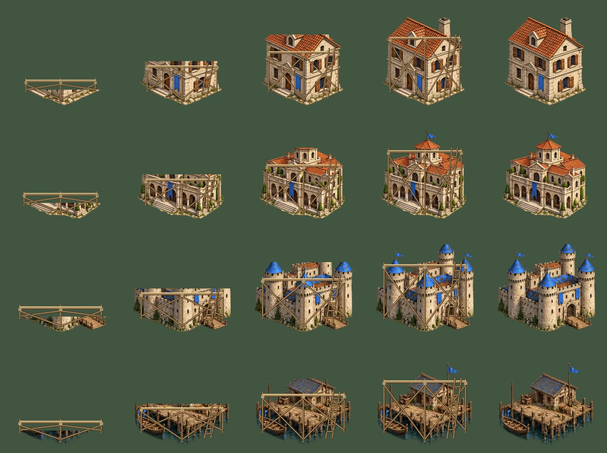

# Shared construction stages — 30 October 2026

Painted buildings now reveal their foundations, lower walls, upper walls and roof finishing in four stages (25/60/90 percent thresholds). Original timber scaffolds include braced posts, plank decks, rope lashings and a ladder. Both the solo battlefield and team-relative battlefield call the same painter. This is staged native artwork plus original vector scaffolding, not newly painted construction or damage sheets. Dedicated sheets and faction architecture remain open.

Completed buildings and placement ghosts retain the exact established source rectangle, dimensions, feet anchor and pixels. Missing/nonpainted artwork retains its established drawing path. The shared painter allocates no canvases or new textures. Solo progress is observed only in current sight or for owned buildings; a hidden building retains its last observed art stage. Unknown hidden stages keep the prior complete-art fallback. Team views use only the existing copied projection. Visual caches are WeakMaps and never enter entities or saves. Controls, simulation, hosting configuration and all artwork/manifest bytes are unchanged. Shell v43 refreshes code.

All 22 building kinds across four palettes have five distinct rendered states (four construction stages and completion): 88 combinations, with zero completed-image component differences. Chromium exercises both real callers, hidden progress retention, unknown-stage fallback and unchanged checkpoints. The contact sheet was visually inspected. All 216 standalone regression files, full Chromium graphics, game/source validation and the graphics inventory check pass locally. Existing checks continue covering stone, gold, berries, wildlife, fish traps, terrain, age artwork, native tint parity and asset-failure fallback. [Evidence](verification/construction-2026-10-30.json).

Large-army measurements now cover both real views, 200- and 800-unit normal armies and an 800-unit all-47-kind/four-palette stress scene. Each repeats three eight-frame pose cycles. Normal armies reach 100 percent warm hits with 128/256 retained canvases (6,848,352/13,696,704 pixels). The diverse stress case reaches 65.61 percent warm hits in solo and 49.29 percent in the team view; peaks are 548/553 retained canvases, both below the 33,554,432-pixel cap. Draw order differs between views. This is retained tint storage only, not total browser/GPU memory or Xbox FPS. [Measurements](verification/large-army-tints-2026-10-30.json).

A bounded ageing-frequency admission experiment reduced solo stress hits to 34.11 percent, so it was discarded; the existing LRU cache is unchanged. Do not substitute fewer evictions for fewer allocations or claim the diverse working set fits the budget. Large-roster optimization remains open. Reproduce the shipped cache measurements with `node tests/browser/large-army-tints-runner.mjs`; `CK_ART_OUTPUT` selects an output directory. `CK_BROWSER_EXECUTABLE` optionally selects an installed Chromium for either browser runner.

Next: architecture variants, dedicated construction/damage art, coherent corpse/effect presentation and the complete interface/icon set. Physical Series S Edge 50/75/100 presets, large land/naval performance and actual-origin installation still require acceptance.

Construction runtime `f6ece0681357b5e69f8df7d1e60542b170c30e0a` is verified live: all 64 production SHA-256 comparisons match source, and Vercel reports READY. Hosted runs 40980875120 /40980875032 /40980875079 fail before any steps; cause remains unverified. Actual-origin browser installation and physical Xbox acceptance remain open.
