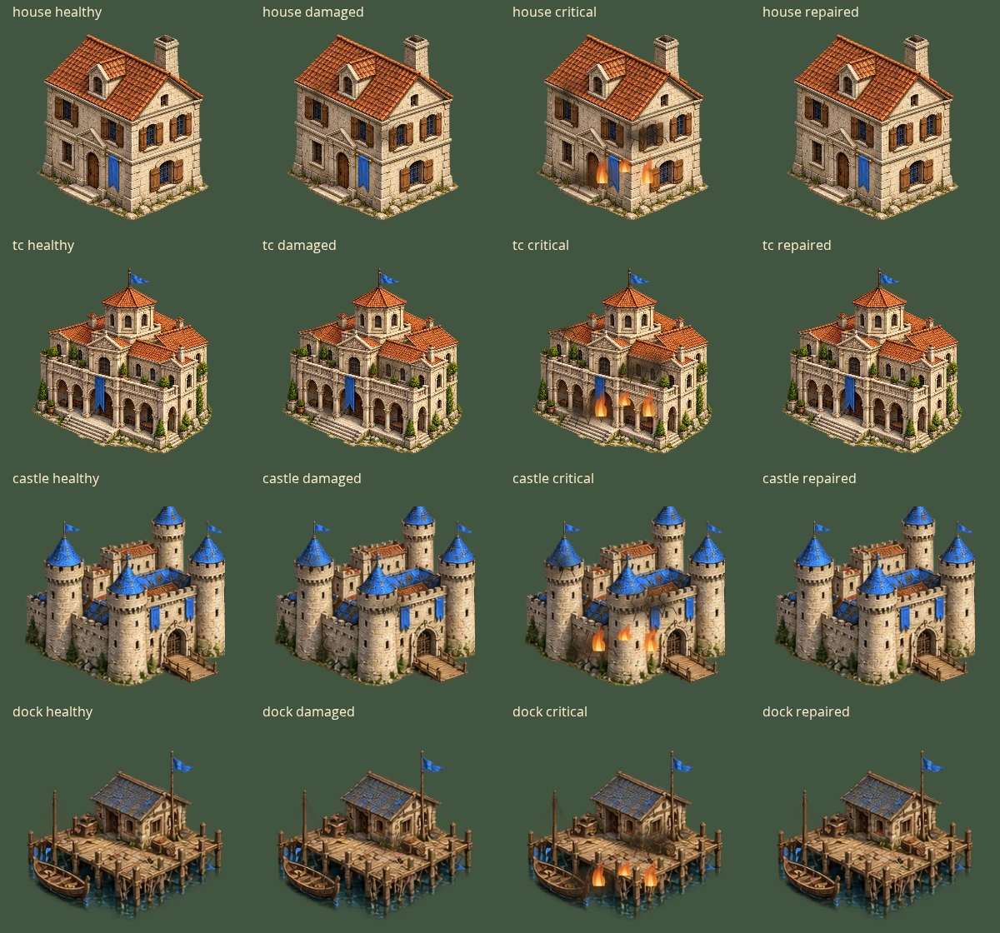
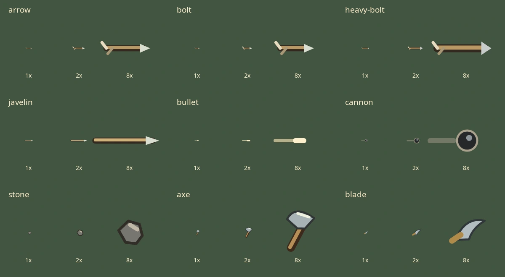

# Building damage and projectile artwork — 30 October 2026

Both battlefields now share native-resolution building scarring and animated fire/smoke, plus nine original vector projectile families. The existing healthy artwork, simulation, controller bindings, saves, original asset bytes, hosting configuration and 128MiB motion-tint cache are unchanged. Shell v44 refreshes code; the active catalogue remains v19 with57 atlases/58 images.

## Building condition

Completed buildings gain moderate damage below66% health and critical damage below33%. Deterministic scorch marks and branched fractures are composited onto their original frame with `source-atop`, preserving its alpha silhouette, dimensions and foot anchor. Healthy/repaired buildings use their original descriptor and source image. Placement ghosts, construction and nonpainted fallbacks retain their established paths. These are shared procedural overlays, not new faction-specific damaged-building sheets.

One global LRU retains at most4,194,304 damage-canvas pixels (16MiB nominal RGBA storage), keyed by source/palette-image identity, crop and damage stage. It does not retain simulation entities. Oversized crops remain drawable without entering the cache; failed canvas allocation retains the original artwork. This is a retained pixel budget, not process/GPU memory: decoded art, full-sheet building palettes, temporary/caller-held canvases and other caches have separate lifetimes. Fire and smoke are drawn without allocating new textures or particles on each frame.

Solo damage art observes owned buildings/current sight and retains a hidden building's last observed stage, including repairs. Unknown hidden damage uses healthy art. Ongoing fire/smoke is suppressed outside current sight. Team views use only their existing copied health projection. No new simulation field or saved observation is introduced.

Chromium checks112 kind/age/palette combinations: all22 building kinds/four palettes, plus all four house/Town Centre ages. Both damaged stages change visible pixels with zero native-alpha differences; geometry and healthy descriptor identity are preserved. Real solo/map callers show damage and clear it after repair. Unknown/hidden damage, hidden repairs, allocation failure, world checksums and three distinct animated effect frames pass. Peak retained storage is4,194,228 pixels/77 canvases, within the limit. An eight-descriptor roster (house/Town Centre, two palettes, two damage stages) has zero warm allocations. Broader four-palette working sets can exceed this separate budget; no universal zero-allocation or Xbox-memory claim is made.

## Projectiles

The shared painter distinguishes arrows, bolts, heavy bolts, javelins, bullets, cannonballs, stones, throwing axes and blades. Weapon family comes from the existing projectile attacker kind; no new ammunition or combat mechanic is introduced. Both views use the shot's fixed launch aim for direction rather than rotating artwork toward its target's current position. Old saves without aim keep neutral visual direction until the existing simulation migration fills it.

The team-relative projection copies only visible, nonexpired shots as `{x,y,style,heading}`. It does not copy target identity, health, coordinates or a mutable entity reference. Solo also suppresses shots outside current sight. Rendering consumes no RNG and creates no projectile textures or particles; trajectory, hit detection, accuracy, damage, splash and save migration remain in the unchanged simulation.

Chromium verifies all9 families at1x/2x in four headings (72 cases), distinct family output, actual solo/map painter calls, current-sight/expired filtering, fixed-aim direction and unchanged world checkpoints. A throwing target getter separately verifies that the copied projection never reads hidden target state. The8x contact-sheet column is for inspection, not a new game zoom preset. Impact/destruction sheets and dedicated ballistic-height artwork remain open.

All218 standalone regression files, complete Chromium battlefield graphics, source/game validation and generated graphics inventory checks pass locally. Existing tests continue covering stone, gold, berries, wildlife, fish traps, house/Town Centre ages, construction, native troop palette parity and image-failure fallback. [Machine-readable evidence](verification/world-effects-2026-10-30.json) records local checks and rollout separately. Physical Xbox Series S Edge, actual-origin browser installation, architecture/faction variants, dedicated work/death/destruction art and the full interface/icon overhaul remain unfinished.
